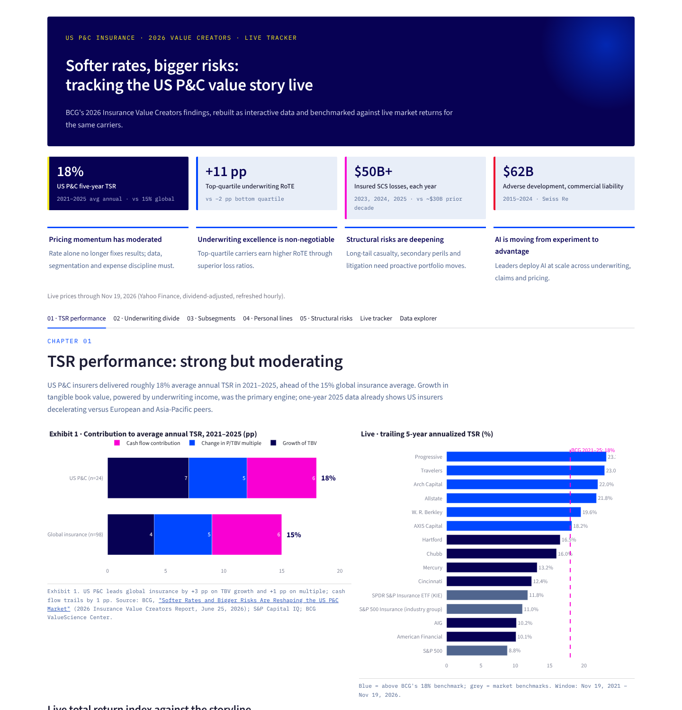

# US P&C Value Creators: Live TSR Tracker

An interactive Streamlit dashboard that rebuilds BCG's 2026 Insurance Value Creators report,
[*Softer Rates and Bigger Risks Are Reshaping the US P&C Market*](https://www.bcg.com/publications/2026/soft-rates-and-big-risks-reshape-the-us-p-and-c-market)
(June 25, 2026), as explorable data and checks its findings against live market returns.



## Storyline

| Tab | What it shows |
|---|---|
| 01 · TSR performance | Exhibit 1 TSR decomposition (US P&C 18% vs global 15%); live trailing 5-yr TSR vs the 18% benchmark; total-return index annotated with storyline events |
| 02 · Underwriting divide | Exhibit 2 RoTE waterfalls; Exhibit 3 company RoTE vs TSR and TSR building blocks; BCG-reported vs live-replicated 2021–25 TSR; 2026 YTD check |
| 03 · Subsegments | Exhibit 4 personal vs commercial decomposition and shift vs 2020–24; Exhibit 5 top/bottom-quartile spread |
| 04 · Personal lines | Auto and homeowners combined ratios, SCS cat losses, auto and homeowners strategic considerations |
| 05 · Structural risks | Nuclear verdicts, litigation funding, $62B adverse development, implications for carriers |
| Live tracker | Live TSR across four windows, upcoming data releases |
| Data explorer | Every dataset, filterable, chartable and downloadable as CSV |

## Data

All report figures live in [`data/`](data) as tidy CSVs, transcribed from the report's exhibits and text:

- `exhibit1_tsr_decomposition.csv` … `exhibit5_tsr_spread.csv`: one file per exhibit
- `market_indicators.csv`: every other statistic cited in the report, with its original source

Live prices come from Yahoo Finance (dividend-adjusted, cached for one hour). See the
methodology notes in the Data explorer tab for caveats.

## Run locally

```bash
pip install -r requirements.txt
streamlit run app.py
```

## Deploy (Streamlit Community Cloud)

1. Sign in at https://share.streamlit.io with GitHub.
2. **Create app** → choose this repo, branch `main`, main file `app.py` → **Deploy**.

Every push to `main` redeploys automatically.

---
Independent analysis. BCG content © 2026 Boston Consulting Group, cited for analysis and commentary. Not investment advice.
